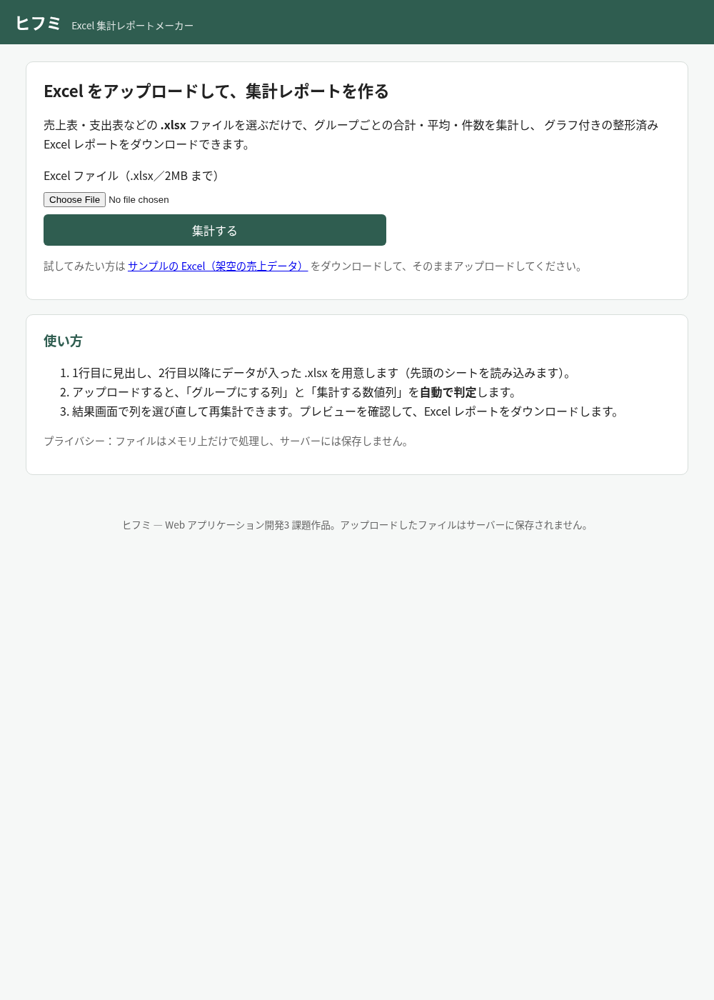
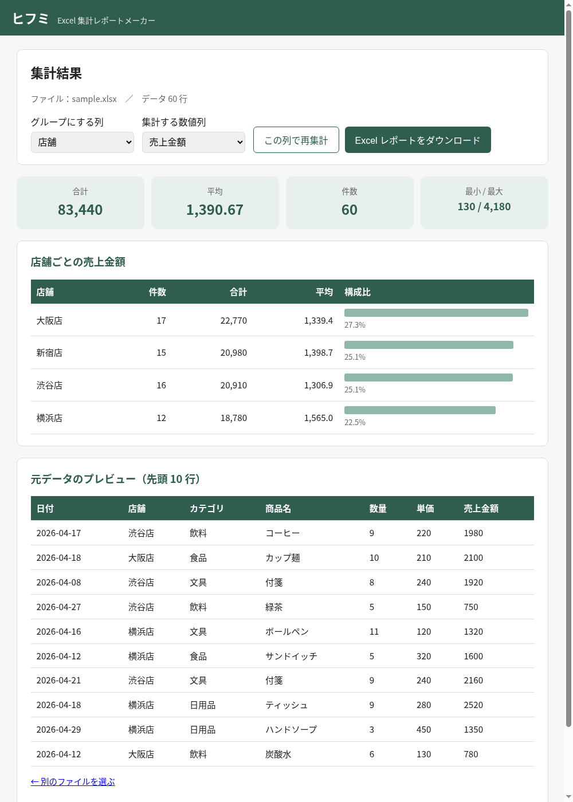

# ヒフミ — Excel 集計レポートメーカー

> Web アプリケーション開発3（ZEN Study）課題作品

売上表や支出表などの **Excel（.xlsx）をアップロードするだけで、グループごとに自動集計し、グラフ付きの整形済み Excel レポートを作ってくれる** サーバーサイド Web アプリです。
Python / FastAPI / Jinja2 で作っています。

## 名前の由来

神道の「ひふみ祝詞（ひふみのりと）」から名付けました。「ひ・ふ・み・よ・い・む・な・や・こ・と」は、一・二・三…と数を数える言葉です。
Excel の数字を数えて、まとめるアプリなので「ヒフミ」にしました。

## 主な機能

- **Excel の読み込み**：.xlsx の先頭シートを読み込み（1行目＝見出し）
- **列の自動判定**：見出しや値の中身から「グループにする列（店舗・カテゴリなど）」と「集計する数値列（売上金額など）」を自動で選択。結果画面で選び直して再集計も可能
- **集計**：合計・平均・件数・最小・最大、グループごとの合計・平均・件数・構成比
- **プレビュー**：集計結果と元データの先頭10行を HTML で表示
- **Excel レポートの出力**：「集計サマリー」シート（集計表＋棒グラフ）と「元データ」シートの2枚。見出しの装飾、列幅の自動調整、行の固定、オートフィルタ付き
- **サンプルファイル**：トップページから架空の売上データ（.xlsx）をダウンロードして、すぐ試せます
- **入力チェックと日本語エラー表示**：拡張子・サイズ（2MB まで）・ファイルの中身・行数の上限、数値列が無い場合など

## 設計のポイント

| 項目 | 内容 |
| --- | --- |
| プライバシー | アップロードしたファイルは**メモリ上だけで処理し、サーバーに保存しません**。結果画面から再集計・ダウンロードするときは、データを画面（フォーム）に持たせて送り直す方式（ステートレス）にしています |
| セキュリティ | Excel の数式インジェクション対策（`=` で始まるセルを文字列として出力）、HTML の自動エスケープ（Jinja2）、サイズ・形式・行数の上限 |
| 構成 | 画面・通信（`main.py`）と集計ロジック（`excel_tools.py`）を分離。集計ロジックは Web に依存しない関数なので単体テストしやすい |
| テスト | pytest で 23 件（集計・列判定・入力チェック・レポート生成・アップロード→ダウンロード） |

## ファイル構成

```
hifumi/
├── main.py              # FastAPI アプリ本体（ルーティング・エラー処理）
├── excel_tools.py       # Excel 読み込み・列の自動判定・集計・レポート生成
├── sample_data.py       # サンプル Excel（架空の売上データ）の生成
├── templates/           # Jinja2 テンプレート（base / index / result / error）
├── static/style.css     # スタイル
├── tests/               # pytest（test_excel_tools.py / test_app.py）
├── docs/                # 画面のスクリーンショット
├── requirements.txt     # 本番用の依存パッケージ
├── requirements-dev.txt # テスト用を加えた依存パッケージ
├── render.yaml          # Render の設定（任意）
└── .python-version      # Python のバージョン
```

## ローカルでの動かし方

Python 3.11 以上が必要です。

```bash
# 1. 仮想環境を作って有効化
python -m venv .venv
source .venv/bin/activate        # Windows: .venv\Scripts\activate

# 2. 依存パッケージをインストール
pip install -r requirements-dev.txt

# 3. テストを実行
pytest

# 4. サーバーを起動
uvicorn main:app --reload
```

ブラウザで <http://127.0.0.1:8000> を開き、「サンプルの Excel」をダウンロードしてアップロードすると動作を確認できます。

## Render（無料プラン）へのデプロイ手順

1. このフォルダを GitHub のリポジトリに push する
2. [Render](https://render.com/) にログインし、**New → Web Service** で、そのリポジトリを選ぶ
3. 次のように設定する
   - **Language**：Python 3
   - **Build Command**：`pip install -r requirements.txt`
   - **Start Command**：`uvicorn main:app --host 0.0.0.0 --port $PORT`
   - **Instance Type**：Free
4. **Create Web Service** を押す。数分で `https://〇〇.onrender.com` が発行される
5. 発行された URL を開いて、サンプルのアップロード→ダウンロードまで動くことを確認する

※ 無料プランは、しばらくアクセスがないとスリープします。最初のアクセスだけ表示に 30 秒〜1 分ほどかかることがあります。
※ Python のバージョンは `.python-version` で指定しています（環境変数 `PYTHON_VERSION` でも指定できます）。

## 制限事項

- 読み込むのは **.xlsx の先頭シートのみ**（.xls・.csv は非対応）
- 上限：ファイル 2MB・20,000 行・50 列
- 数式セルは、Excel で保存されたときの計算結果の値を読み込みます（計算結果が保存されていないファイルは空欄扱い）
- 1行目を見出しとして扱います

## 画面

| トップ | 集計結果 |
| --- | --- |
|  |  |
